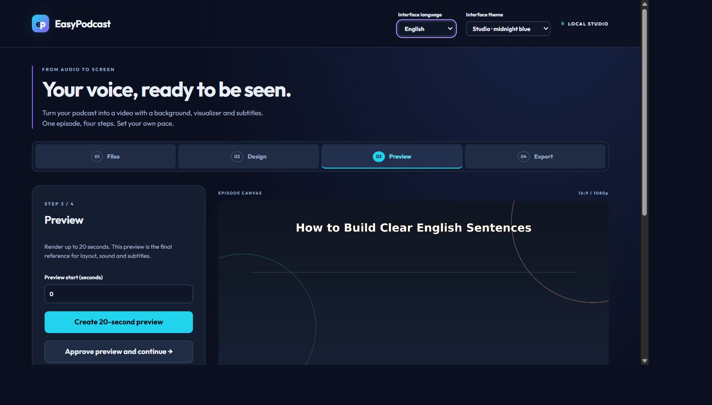

# EasyPodcast

A local web studio that turns podcast audio into a 1080p MP4 with a background, title, optional logo, audio visualizer and subtitles. Upload an SRT or generate it locally with Whisper. Optional estimated word timing highlights the spoken word. No Xcode is required.

**Listen. Learn. Speak with confidence**

The interface supports English and Spanish. New browser profiles start in English with the Studio theme; Classic remains available. Interface preferences never change the exported video.



## Requirements

Python 3.12+, Node 22.12+ or 24, Git, FFmpeg and FFprobe in PATH. FFmpeg needs libx264, AAC, libass, showwaves, showfreqs, colorkey and overlay. The bundled fonts include their own licenses. See [verification status](docs/IMPLEMENTATION_STATUS.md) for tested platforms and limitations.

## Windows setup

```powershell
git clone https://github.com/dafermen/EasyPodcast.git
cd EasyPodcast
python -m venv .venv
.\.venv\Scripts\python.exe -m pip install -r backend\requirements.lock
.\.venv\Scripts\python.exe -m pip install -e backend --no-deps
Copy-Item .env.example .env
npm.cmd --prefix frontend ci
npm.cmd --prefix frontend run build
npm.cmd --prefix transcription ci
.\.venv\Scripts\python.exe scripts\doctor.py
powershell -ExecutionPolicy Bypass -File scripts\start.ps1
```

Do not overwrite an existing .env. Open http://127.0.0.1:8000. Keep the terminal running. Production-style local use serves the compiled frontend and API from the same origin.

## macOS setup

Install Python, Node and native FFmpeg (for example with Homebrew). Clone the repository, then run:

```sh
python3 -m venv .venv
.venv/bin/python -m pip install -r backend/requirements.lock
.venv/bin/python -m pip install -e backend --no-deps
cp .env.example .env
npm --prefix frontend ci
npm --prefix frontend run build
npm --prefix transcription ci
.venv/bin/python scripts/doctor.py
sh scripts/start.sh
```

Create fresh dependencies on each OS; never copy .venv or node_modules between computers. Native macOS behavior still needs validation on the target Mac.

## First episode

1. Files: upload audio and SRT, or choose local subtitle generation. Background and logo are optional.
2. Review generated subtitles before approving them. Word timestamps are estimates.
3. Design: configure manually or import a previously exported design JSON. Adjust typography, title position, visualizer and logo. Save changes.
4. Select **Approve background and continue**. Generate and watch a preview of up to 20 seconds; then approve it.
5. Export the full episode and download the MP4, SRT, background and design JSON.

New studio tools: reusable brand templates with background/logo; debounced design recovery drafts; title/logo dragging, resize handles and alignment guides; subtitle cue timeline with audio playback; pre-export layout checks; 16:9, 9:16 and square video formats. See [saved projects and recovery](docs/PROJECTS.md).

Changing settings invalidates earlier previews. A design JSON contains settings, not media or a resumable session. There is no lip synchronization or channel publishing.

## Files, sessions and costs

Editing/render sessions still use RAM and temporary workspaces (24-hour completed, 15-minute failed and four-hour active defaults). A separate local SQLite library now keeps project inputs, settings, subtitles and completed artifacts across reloads/restarts. Open **Project library → Continue project** to recover a session; Duplicate creates an independent project. Keep originals and backups: local persistence is not cloud synchronization or protection from disk failure.

Audio, subtitles and local transcription stay on the computer. Model files download from Hugging Face on first use and are cached. Optional image generation sends only visual context to OpenAI after an explicit action, can cost money and requires backend configuration. No paid call occurs at startup or in tests.

## Documentation map

- [User guide](docs/USER_GUIDE.md) and [design controls](docs/DESIGN_CONTROLS.md)
- [Start learning the code](docs/JUNIOR_GUIDE.md), [development](docs/DEVELOPMENT.md) and [complete source reference](docs/CODE_REFERENCE.md)
- [Architecture](docs/ARCHITECTURE.md), [API](docs/API.md) and [configuration](docs/CONFIGURATION.md)
- [Projects, autosave and templates](docs/PROJECTS.md)
- [Localization and themes](docs/LOCALIZATION.md), [transcription](docs/TRANSCRIPTION.md) and [image provider](docs/OPENAI_PROVIDER.md)
- [Testing](docs/TESTING.md), [privacy/files](docs/PRIVACY_AND_FILES.md), [status](docs/IMPLEMENTATION_STATUS.md), [roadmap](docs/ROADMAP.md), [product specification](docs/PRODUCT_SPEC.md)
- [Contributing](CONTRIBUTING.md), [changelog](CHANGELOG.md) and [third-party notices](THIRD_PARTY_NOTICES.md)

The original application code is MIT licensed. Font files and dependencies retain their own licenses; see LICENSE and THIRD_PARTY_NOTICES.md.
