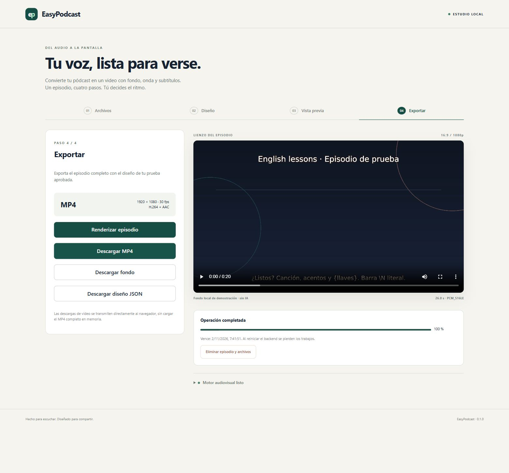

# EasyPodcast

Estudio web **local** para convertir audio en MP4 1080p con fondo, título, logo opcional, visualizador y subtítulos. Puedes aportar SRT o generarlo desde el audio con Whisper local, con resaltado amarillo de la palabra actual. Interfaz en español. React/TypeScript/Vite, FastAPI, FFmpeg y un worker Node de transcripción. No requiere Xcode.

El flujo permite validar archivos, diseñar, aprobar un fondo, revisar una prueba de hasta 20 segundos y exportar el episodio. Hay un fondo determinista sin IA; también puedes cargar PNG/JPEG. OpenAI es opcional y tiene costes externos. No se publica en YouTube.



## Requisitos

Python 3.12 o posterior; Node 22.12+ o 24; FFmpeg y FFprobe con libx264, AAC, libass, showwaves, showfreqs, colorkey y overlay. Git. La fuente DejaVu Sans está incluida con licencia. Windows fue probado aquí; macOS está documentado y requiere validación en tu Mac. Estado exacto: [IMPLEMENTATION_STATUS](docs/IMPLEMENTATION_STATUS.md).

## Windows · PowerShell

Desde `C:\Projects\EasyPodcast`:

```powershell
python -m venv .venv
.\.venv\Scripts\python.exe -m pip install -r backend\requirements.lock
.\.venv\Scripts\python.exe -m pip install -e backend --no-deps
Copy-Item .env.example .env
Set-Location frontend
npm.cmd ci
npm.cmd run build
Set-Location ..
npm.cmd --prefix transcription ci
.\.venv\Scripts\python.exe scripts\doctor.py
powershell -ExecutionPolicy Bypass -File scripts\start.ps1
```

Abre **http://127.0.0.1:8000**. El build se sirve desde FastAPI; un solo origen. Si `.env` ya existe, consérvalo. En esta laptop ya se preparó el entorno virtual y se instalaron las dependencias.

## macOS · Terminal

Instala Python, Node y FFmpeg con tu gestor habitual; si usas Homebrew: `brew install python node ffmpeg`. Después:

```bash
git clone https://github.com/dafermen/EasyPodcast.git
cd EasyPodcast
python3 -m venv .venv
.venv/bin/python -m pip install -r backend/requirements.lock
.venv/bin/python -m pip install -e backend --no-deps
cp .env.example .env
cd frontend
npm ci
npm run build
cd ..
npm --prefix transcription ci
.venv/bin/python scripts/doctor.py
bash scripts/start.sh
```

## Desarrollo y pruebas

Backend: desde `backend`, ejecuta `..\.venv\Scripts\python.exe -m uvicorn app.main:app --host 127.0.0.1 --port 8000 --workers 1 --no-access-log`. En otra terminal, desde `frontend`: `npm.cmd run dev`. Abre http://127.0.0.1:5173. En Mac usa `../.venv/bin/python` y `npm`.

```powershell
# Desde la raíz, Windows
.\.venv\Scripts\python.exe -m pytest backend\tests -q
Set-Location frontend
npm.cmd test
npm.cmd run build
```

Datos sintéticos: `python scripts/fixtures.py --output <carpeta-temporal>`. Pipeline sin navegador: `python scripts/render_cli.py --audio <demo.wav> --srt <demo.srt> --output <prueba.mp4>` usando el Python del entorno. No incluyas medios personales en Git.

## Configuración y límites

`.env.example` documenta todas las variables. `OPENAI_API_KEY` e `IMAGE_MODEL` solo se leen en backend; ambos vacíos desactivan IA sin impedir exportar. Consulta [proveedor](docs/OPENAI_PROVIDER.md). No hay llamadas al servicio al arrancar ni en tests.

Límites de producto configurables: audio 120 minutos/1 GiB; SRT 5 MiB; imagen 20 MiB/25 MP; un render, dos trabajos en cola, ocho trabajos retenidos y una carga simultánea. Se comprueban bytes durante la recepción y contenido real con FFprobe/Pillow. Se usa un presupuesto preventivo de disco de 1 MB por segundo más reserva; no es una predicción del tamaño final. Benchmark sintético Windows de 30 min: 12 min de render y pico RSS agregado de 391 MiB; 120 min todavía sin verificar. Detalles en [TESTING](docs/TESTING.md).

Los medios se escriben temporalmente en tu equipo, fuera del repositorio. Vencen normalmente 60 minutos después de una operación; fallos/cancelaciones, 15 minutos; operaciones activas, máximo cuatro horas. El polling no renueva TTL. Reiniciar pierde los trabajos. **Recargar la página pierde el token de la interfaz**: descarga primero o vuelve a cargar los archivos. No hay cuentas ni historial.

## Solución de problemas

- Motor no listo: ejecuta el doctor; instala una distribución FFmpeg con los filtros y encoders indicados y reinicia backend.
- Puerto ocupado: cierra la otra instancia. No añadas workers; el registro es en memoria y hay bloqueo exclusivo del temporal.
- SRT rechazado: conviértelo a UTF-8 y corrige tiempos; no hay alineación automática. El recorte fuera del audio requiere marcar la casilla.
- Imagen IA rechazada: revisa clave, modelo, tamaño, calidad y acceso de tu cuenta. No se reintentan llamadas automáticamente.
- Cola llena o descarga activa: espera y reintenta. Cambiar diseño invalida pruebas y videos anteriores.

Documentos: [producto](docs/PRODUCT_SPEC.md), [arquitectura](docs/ARCHITECTURE.md), [desarrollo](docs/DEVELOPMENT.md), [guía junior](docs/JUNIOR_GUIDE.md), [API](docs/API.md), [usuario](docs/USER_GUIDE.md), [privacidad](docs/PRIVACY_AND_FILES.md), [pruebas](docs/TESTING.md), [roadmap](docs/ROADMAP.md).

La aplicación está preparada para loopback, no para exposición pública. El código propio se distribuye bajo la [licencia MIT](LICENSE). Fuentes y dependencias mantienen sus licencias; consulta [avisos](THIRD_PARTY_NOTICES.md).

## Generar subtítulos desde audio

En Archivos elige «Generar desde el audio (local)», idioma y Tiny/Base. El SRT deja de ser obligatorio. Revisa el texto generado antes de continuar. En Diseño puedes activar/desactivar el resaltado de palabra y elegir color (amarillo inicial). El audio permanece local; primera vez descarga modelo de Hugging Face, caché persistente fuera del repositorio. No se necesita API ni se cobra por llamadas. Editar/reimportar el SRT elimina los tiempos por palabra; no se inventan para SRT propios. Guía completa: [TRANSCRIPTION](docs/TRANSCRIPTION.md).

## Tipografía y logo (0.3.0)

Diseño → Tipografía y logo permite fuente y tamaño de título/subtítulos independientes, tres fuentes incluidas y seis posiciones de logo con margen. Guarda cambios y genera otra prueba antes de exportar. Design añade title_font, subtitle_font, title_font_size, logo_position y logo_margin. Fuentes por /api/fonts/{key}; logo autenticado por artifacts/logo. Detalles y verificaciones en docs/DESIGN_CONTROLS.md.

## 0.4.0 · Fuentes amigables y negrilla (2026-11-03)

Diseño → Tipografía y logo incorpora Negrilla en el título y fuentes Nunito, Fredoka, Rounded y Poppins. Regular/Bold locales; JSON conserva title_bold (true por defecto). 69 pruebas backend y 10 frontend pasaron; pruebas multimedia de las cuatro familias en ambos pesos. Ver docs/DESIGN_CONTROLS.md y THIRD_PARTY_NOTICES.md para detalles/licencias.
