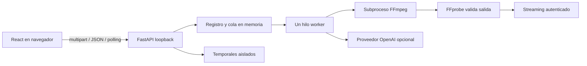

# Arquitectura

React mantiene estado efímero; TypeScript define contratos del cliente. FastAPI y Pydantic validan la configuración; FFprobe valida contenido y FFmpeg procesa sin cargar el episodio completo en RAM. Se evita FFmpeg.wasm por consumo y límites del navegador. No hay base de datos ni servicios auxiliares.

`app/main.py` expone API y frontend compilado; `uploads.py` procesa multipart incremental con límites por parte. `models.py` valida números, colores y enums. `subtitles.py` parsea SRT, recorta segmentos y genera ASS. `media.py` verifica capacidades, imágenes, audio y ejecuta FFmpeg. `images.py` encapsula SDK. `jobs.py` administra registro, cola, temporales, TTL y worker.

## Estado y concurrencia

`ready → queued → generating_image | rendering_preview | rendering_video → completed | failed`. Cancelación: `queued/activo → cancelling → cancelled`. Al eliminar se marca para borrado y se cancela; el cleaner borra cuando el worker terminó y lectores=0. Expiración devuelve 410 mientras el registro existe; luego 404. Entradas canceladas se conservan hasta TTL. Cada operación toma una copia profunda de Design.

Un proceso Uvicorn; un hilo worker y uno de limpieza. Cola de dos pendientes, una carga simultánea. Un file lock exclusivo impide dos instancias sobre el mismo temporal. El render supervisa el subproceso, lee ambas tuberías con hilos, limita cola de stderr y deriva progreso de `out_time_us`. Solo marca 100% tras exit=0 y FFprobe válido. Generación de imagen no muestra porcentaje inventado. La cancelación de una llamada externa se aplica al volver la respuesta/timeout: no promete detener la facturación.

## Archivos

UUID y token aleatorios; nombres de entrada ignorados para rutas. Cada trabajo usa audio.bin, original.srt, background.png, logo.png opcional, subtitles.ass y salidas internas. Los filtros solo contienen nombres internos relativos; evita escapes de unidad Windows. FFmpeg usa lista de argumentos, shell=False. El render parcial se renombra después de validar. Los lectores tienen una concesión liberada incluso al desconectar; la limpieza espera.

Raíz temporal con marcador, inicialmente vacía y exclusiva; no debe ser el repositorio. Al arrancar elimina solo subcarpetas UUID administradas, sin seguir symlinks. `filelock` serializa instancias. No hay reanudación tras reinicio.

## Autenticación local

API exige X-Job-Token en memoria del navegador. Creación también establece cookie HttpOnly/SameSite=Strict por trabajo, limitada a `/api/jobs/{id}/artifacts`; permite `<video>` y descarga navegable con Range sin Blob gigante. Nunca token en query. No se permite CORS wildcard; Origin permitido para mutaciones y Host limitado. Sin Origin una mutación se rechaza. Producción local sirve un origen; Vite hace proxy en desarrollo. No exponer en LAN/Internet sin otra fase de autenticación y TLS.

## Transcripción local (0.2.0)

La cola incorpora transcribing. app/transcription.py supervisa FFmpeg PCM y el worker Node transcription/worker.mjs (Transformers.js, Whisper Tiny/Base CPU q8). Audio por ventanas de máximo 30 segundos, palabras con tiempos estimados y agrupación en cues breves. Revisión/aprobación de subtítulos antes de Diseño. ASS genera intervalos con solo la palabra activa coloreada; clip_cues conserva el desplazamiento textual al cortar una frase. Los SRT editados pierden los tiempos internos; no se usa alineación inventada. Caché de modelos persistente separada del temporal y sin audio. Ver TRANSCRIPTION.md.
