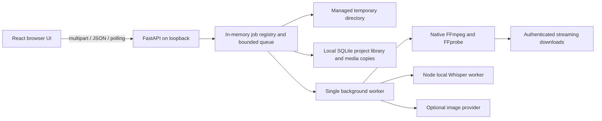

# Architecture

## Layers and responsibilities

The browser owns form drafts, the current step and the job token. TypeScript describes the client contract but is not runtime security. Pydantic validates untrusted requests on the server. FFprobe verifies actual media content; extensions and MIME types are not trusted.

`main.py` exposes endpoints and the compiled frontend. `uploads.py` receives multipart chunks without loading an entire audio file into RAM. `models.py` defines bounded settings. `subtitles.py` parses SRT, clips cues, measures fonts and creates ASS. `media.py` supervises FFmpeg. `jobs.py` owns lifecycle, queue, cancellation and cleanup. `transcription.py` supervises the separate Node process. `images.py` wraps the optional provider. `fonts.py` maintains the allowlist.

## Request lifecycle

Uploading creates a random UUID directory and token, validates audio/SRT/images, and returns a job snapshot. The frontend saves the token in memory. Saving a design sends a complete Design object; omitted fields reset to defaults. Approval is explicit. Enqueueing copies the design so later mutable state cannot alter the running operation.

A worker takes one queued operation, runs it and validates the output before publishing the artifact. A partial MP4 is renamed only after success. GET status exposes a snapshot; React polls every 1.5 seconds. A library checkpoint is written after creation, explicit saves/approvals, subtitle corrections and worker completion. Media downloads use HTTP Range and streaming, avoiding a full in-memory Blob.

## Concurrency and states

States: ready, queued, transcribing, generating_image, rendering_preview, rendering_video, cancelling, cancelled, completed and failed. One Uvicorn process and one worker are required: multiple processes would have different registries. A file lock prevents two instances sharing TEMP_ROOT. A reentrant lock protects shared state; the queue is bounded to two pending operations by default. One upload is accepted at a time.

Rendering and transcription use subprocesses, not the event loop. Reader threads drain progress and error pipes to prevent deadlock. Progress follows processed media time. Model/image loading can be indeterminate. Cancellation terminates the process tree/group; image cancellation cannot reverse external billing.

## Managed files and cleanup

Input names are internal constants such as audio.bin, original.srt, background.png and logo.png. The temporary root needs a marker and exclusive ownership. Cleanup accepts only direct UUID child directories and handles symlinks without following them. Active download readers hold a lease: deletion waits until the response completes. Restart removes managed job directories, but the separate durable library can rebuild a workspace from its saved inputs, cues, configuration and outputs. Interrupted operations are never automatically restarted.

## Local trust boundary

Bind to loopback. Mutations require an allowed Origin; Host is allowlisted. APIs require X-Job-Token. Artifact navigation can use a job-specific HttpOnly SameSite cookie scoped to artifacts. Tokens never appear in URLs. Media paths never come from uploaded filenames. FFmpeg receives argument lists with shell=False and controlled relative filter paths, avoiding Windows drive-letter escaping and shell injection. This design is not Internet authentication.

## Presentation preferences

Language and theme belong to the browser, not Design. i18n.ts exposes an external locale store; App subscribes through useSyncExternalStore so changing language rerenders labels while preserving episode state. Catalog translations are only applied to interface messages, never user titles, descriptions or subtitle text. The theme uses a root data-theme attribute and scoped CSS; it does not restyle the video composition.

## Durable library and recovery

library.py stores metadata in SQLite plus controlled UUID media directories under LIBRARY_ROOT. It copies media with bounded-memory file operations and atomic per-file replacement; unchanged fingerprints avoid recopying long audio after every setting change. Project manifests omit tokens, thread events and subprocess handles. Templates copy only settings/background/logo, never audio or subtitles. Saved projects are not automatically pruned.

POST /library/session issues an HttpOnly SameSite local capability, protected by the existing Origin guard. The owner key stays in a private local file, never browser JavaScript/localStorage/URLs. Library listing, covers, open/duplicate, drafts and templates require this cookie; job actions still require X-Job-Token. This is a local single-user boundary, not Internet/multi-user authentication.

Open reuses an idle live workspace when possible, or builds one with a fresh token after restart. At workspace capacity, an idle safely archived session can be evicted; durable files remain. Active/read-held sessions are protected. Drafts include the last saved Design as a base version: a late request cannot replace a newer explicit save. Browser autosave is debounced and pagehide makes a best-effort keepalive flush; only an acknowledged draft is guaranteed written. Saving settings/approvals remains explicit. Subtitle edits still require Save corrections.

Preflight uses the same ASS/font layout rules as rendering and reports blockers/warnings before export. Formats share a dimension-aware frame contract. Uploaded backgrounds retain a normalized source-aspect PNG in addition to the baseline landscape image; each render fits it with padding instead of cropping faces. Direct manipulation maps displayed pointer deltas back into output pixels.
